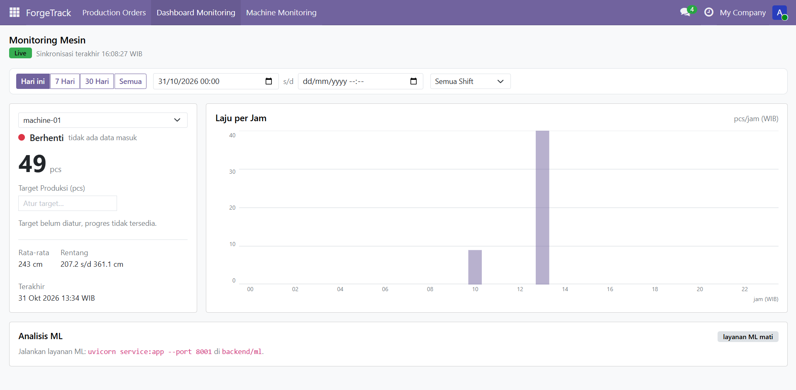
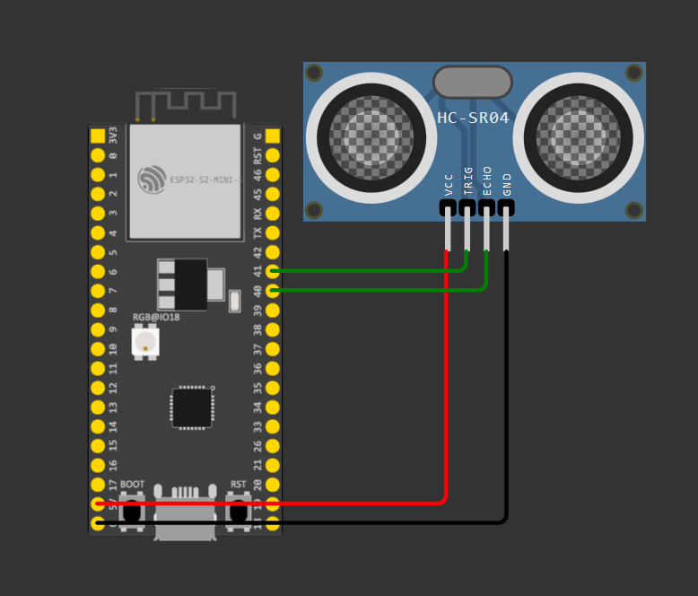

# ForgeTrack

ForgeTrack adalah simulasi kecil pabrik pintar. Ada mesin yang menghitung barang
lewat sensor, datanya dikirim lewat MQTT, disimpan di Odoo, lalu ditampilkan di
dasbor monitoring. Dasbor juga menampilkan hasil analisis ML: perkiraan jam
selesai produksi, deteksi mesin yang melambat, dan rekomendasi target harian.

Semua sensor disimulasikan di Wokwi, jadi proyek ini bisa dijalankan tanpa
perangkat keras asli.



## Cara Kerja

Alur data dari sensor sampai layar dasbor:

```
Wokwi (ESP32-S2 + HC-SR04)
        │  publish MQTT: factory/machine-01/telemetry
        ▼
tunnel TCP openport.pw  (Wokwi jalan di browser, tidak bisa akses laptop langsung)
        ▼
Mosquitto broker (Ubuntu WSL, port 1883)
        │  didengarkan oleh
        ▼
backend/subscriber.py ──► Odoo (forgetrack.machine.reading)
        │                        │
        │                        ▼
        │              backend/ml (FastAPI, port 8001)
        │              ETA, anomali, forecast
        │                        │
        ▼                        ▼
        Odoo menyimpan juga hasil ML (forgetrack.ml.event)
                                 │
                                 ▼
                     Dasbor OWL di Odoo (polling 5 detik)
```

Penjelasan tiap bagian:

1. **Wokwi** menjalankan ESP32-S2-MINI dengan sensor jarak HC-SR04. Pin sensornya
   memang dipasang, tapi angka jaraknya disimulasikan bolak-balik di atas dan di
   bawah 200 cm supaya demo tidak butuh perangkat keras. Setiap barang lewat,
   sketch mengirim satu pesan MQTT berisi `device_id` dan `distance_cm` ke topik
   `factory/machine-01/telemetry`. Satu pesan dihitung sebagai satu pcs. Kode
   lengkap dan cara pakainya ada di [`firmware/`](firmware/README.md).

   

2. **Mosquitto** adalah broker MQTT. Broker ini jalan di Ubuntu WSL. Karena
   Wokwi berjalan di browser orang lain, dia tidak bisa menghubungi
   `localhost`. Jadi alamat broker dibuka lewat tunnel TCP di openport.pw, lalu
   diteruskan ke port 1883 di WSL. Subscriber di Windows cukup terhubung
   langsung ke IP WSL. Alamat broker dan topiknya diatur di `backend/.env`,
   sedangkan alamat tunnel diisi di sketch Wokwi.

3. **`backend/subscriber.py`** mendengarkan topik MQTT. Setiap pesan masuk
   langsung dikirim ke Odoo lewat JSON API (`/json/2/...`) memakai API key,
   tanpa perlu menulis SQL. Data disimpan sebagai bacaan mesin.

4. **Odoo** menyimpan semua bacaan mesin dan menyediakan halaman dasbor.
   Selain itu ada menu produksi biasa: production order dengan status Draft,
   Confirmed, dan Done. Hasil analisis ML juga disimpan di Odoo supaya bisa
   diaudit nanti.

5. **Layanan ML** adalah aplikasi FastAPI terpisah (bukan bagian dari Odoo).
   Layanan ini membaca data bacaan dari Odoo, menghitung tiga hal, lalu
   menyajikannya lewat HTTP. Dasbor mengambil hasilnya dan menampilkannya di
   kartu "Analisis ML". Kalau layanan ML mati, dasbor tetap jalan normal dan
   hanya menampilkan pesan "layanan ML mati".

## Fitur Dasbor

- Status mesin **Running** atau **Berhenti** ditentukan dari ada tidaknya data
  MQTT yang masuk. Kalau tidak ada data lebih dari 5 menit, mesin dianggap
  berhenti. Tidak ada tombol manual, jadi status selalu jujur.
- Jumlah produksi hari ini, target produksi, dan progress bar.
- Grafik "Laju per Jam" 24 jam dalam bentuk SVG tanpa library tambahan.
- Filter cepat: Hari ini, 7 Hari, 30 Hari, Semua, rentang tanggal bebas, dan
  filter shift.
- Semua waktu ditampilkan dalam WIB, format 24 jam.
- Dasbor menyegarkan diri tiap 5 detik dan aman dipakai di layar kecil
  (HP maupun tablet).

## Fitur ML

| Fitur | Endpoint | Model | Hasil |
|-------|----------|-------|-------|
| ETA produksi | `GET /eta` | Random Forest + baseline `sisa / laju` | Perkiraan jam selesai dan status terlambat |
| Deteksi anomali | `GET /anomalies` | EMA thresholding + z-score (bucket 5 menit) | Alert saat laju turun drastis |
| Forecast harian | `GET /forecast` | Holt-Winters musiman mingguan, fallback rata-rata hari | Rekomendasi target besok |

Detail model, cara kerja, dan cara mengujinya ada di
[`backend/ml/README.md`](backend/ml/README.md).

Beberapa hal yang perlu diketahui:

- ETA memakai Random Forest, tapi hasilnya dicampur dengan laju 10 menit
  terakhir supaya lonjakan sesaat tidak membuat perkiraan meloncat jauh.
- Anomali sengaja memakai ambang yang gampang dijelaskan (turun 75 persen atau
  z-score di atas 2), bukan model kotak hitam, supaya bisa dipertanggungjawabkan.
- Forecast baru memakai Holt-Winters setelah data harian cukup (sekitar 14
  hari). Sebelum itu, dipakai rata-rata hari yang sama sebagai cadangan.
- Model dilatih ulang di memori, tidak disimpan ke disk. Untuk data sebesar ini
  itu masih cukup.

## Struktur Proyek

```
ForgeTrack/
├── addons/forgetrack_mrp/          modul Odoo: produksi, bacaan mesin, dasbor
├── backend/
│   ├── subscriber.py              jembatan MQTT ke Odoo
│   ├── odoo_client.py             kirim data lewat JSON API Odoo
│   ├── requirements.txt
│   ├── .env                       alamat Odoo dan MQTT
│   └── ml/                        layanan ML (FastAPI)
├── docs/                          gambar untuk dokumentasi
├── firmware/                      sketch Wokwi (ESP32 + HC-SR04)
├── compose.yaml                   Odoo 19 + PostgreSQL 15
└── Readme.md
```

## Yang Dibutuhkan

- Docker Desktop
- Python 3.10 atau lebih baru
- Ubuntu WSL dengan Mosquitto untuk broker MQTT
- Akun Wokwi (simulasi jalan di browser)

## Menjalankan Proyek

Urutannya penting. Broker harus hidup dulu, baru subscriber, baru layanan ML.

### 1. Siapkan broker MQTT di WSL

Pasang dan jalankan Mosquitto di Ubuntu WSL pada port 1883. Cek alamat IP WSL
dengan `hostname -I`, lalu masukkan alamat itu ke `backend/.env`. Subscriber
memakai alamat ini karena dia jalan di Windows.

```env
MQTT_BROKER=172.17.226.151
MQTT_PORT=1883
MQTT_TOPIC=factory/machine-01/telemetry
```

IP WSL bisa berubah setelah Windows atau WSL di-restart. Kalau subscriber
mengeluh tidak bisa connect, cek IP ini dulu.

### 2. Buat tunnel untuk Wokwi

Wokwi berjalan di browser, jadi dia butuh alamat publik untuk bisa mencapai
Mosquitto di laptop. Buat tunnel TCP di https://openport.pw yang diarahkan ke
port 1883, lalu catat alamat dan port yang diberikan. Nilainya dimasukkan ke
`firmware/wokwi-machine-counter.ino`:

```cpp
const char* mqttServer = "openport.pw";
const int mqttPort = 43102;   // ganti sesuai tunnel yang aktif
```

Alamat dan port tunnel bisa berubah tiap sesi. Kalau nanti sensor tidak masuk
padahal subscriber hidup, cek dua baris ini.

### 3. Jalankan Odoo dan database

```powershell
docker compose up -d
```

Buka http://localhost:8069, buat database `forgetrack_db`, lalu install modul
**ForgeTrack MRP** lewat Apps. Setiap kali kode modul diubah, jalankan upgrade:

```powershell
docker exec forgetrack-web-1 odoo -d forgetrack_db -r odoo -w odoo --db_host db -u forgetrack_mrp --stop-after-init
docker restart forgetrack-web-1
```

### 4. Siapkan Python dan isi `.env`

Sekali saja:

```powershell
cd backend
python -m venv .venv
.venv\Scripts\pip install -r requirements.txt
Copy-Item .env.example .env
```

Lalu isi `ODOO_API_KEY` dengan API key dari Odoo (Settings, Developer, API Keys).
API key ini dipakai subscriber untuk menulis data ke Odoo.

### 5. Jalankan subscriber

```powershell
cd backend
.venv\Scripts\python subscriber.py
```

Kalau berhasil, akan muncul tulisan "Terhubung ke Mosquitto" dan setiap data
sensor yang masuk ikut tercetak di terminal.

### 6. Jalankan layanan ML

Terminal terpisah:

```powershell
cd backend\ml
..\.venv\Scripts\pip install -r requirements.txt
..\.venv\Scripts\python -m uvicorn service:app --host 0.0.0.0 --port 8001
```

Cek cepat:

```powershell
curl http://localhost:8001/eta?machine_id=machine-01&target=500
```

### 7. Jalankan simulasi Wokwi

Buka proyek Wokwi di browser, tempel isi
[`firmware/wokwi-machine-counter.ino`](firmware/wokwi-machine-counter.ino),
pastikan alamat tunnel sudah benar, lalu start simulasi. Setiap barang lewat,
satu pesan MQTT terkirim dan subscriber mencetaknya di terminal.

### 8. Buka dasbor

Buka http://localhost:8069 lalu pilih menu **Dashboard Monitoring**. Isi
target produksi di kotak "Atur target" supaya progress bar dan ETA ikut aktif.

## Port yang Dipakai

| Port | Dipakai oleh | Keterangan |
|------|--------------|------------|
| 8069 | Odoo | dasbor dan API |
| 5432 | PostgreSQL | internal Docker |
| 8001 | Layanan ML | hanya dibaca dasbor lewat browser |
| 1883 | Mosquitto | broker MQTT di WSL |

## Catatan dan Keterbatasan

- Proyek ini dibuat untuk belajar, bukan untuk produksi. Belum ada
  autentikasi MQTT, retry queue, maupun pengamanan tambahan.
- Tunnel openport.pw bersifat publik. Siapa pun yang tahu alamatnya bisa ikut
  publish ke broker, jadi matikan tunnel kalau tidak sedang dipakai.
- Modul Odoo belum menghitung Bill of Materials atau update stok otomatis
  seperti MRP penuh.
- Simulasi Wokwi mengirim jarak sensor, bukan sinyal "mesin mati". Karena itu
  jeda panjang tanpa data tetap dianggap anomali oleh layanan ML. Kontrak topik
  berikutnya bisa ditambah `factory/<id>/state` untuk memperbaikinya.
- API key di `.env` harus diganti dengan milik sendiri sebelum repo ini dipakai
  orang lain.
